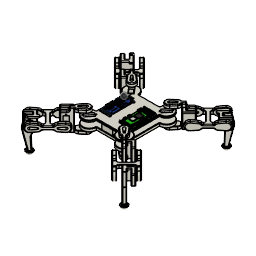

# Quadruped Robot

A 12-servo, 3D-printed quadruped. It was designed in Fusion 360, exported to URDF, and simulated in MuJoCo. A trot gait controller drives it in the sim, or on the real robot through a PCA9685 servo board.



## What's here

| Folder | What | Status |
|---|---|---|
| `controller/ik_controller.py` | Trot gait controller (keyboard driven) | Works in sim. Hardware mode is untested |
| `mujoco/robot.xml` | MuJoCo model with position actuators | Works |
| `description/` | ROS 2 package `quadruped_description`: URDF (`urdf/quadruped.urdf.xacro`) + STL meshes, originally exported by [fusion2urdf-ros2](https://github.com/dheena2k2/fusion2urdf-ros2) | Source of the model |
| `cad/` | Fusion 360 designs, see below | Open in Fusion 360 |
| `experimental/` | RL training, URDF-to-MuJoCo conversion scripts, pose tools, Isaac Sim USD files | **Didn't work / untested**, see [its README](experimental/README.md) |
| `tests/` | Gait unit tests, hardware mapping tests (fake servo board), headless sim tests (stands, walks, turns) | Pass |

### CAD files

| File | What |
|---|---|
| `cad/quadruped-v2-may-2026.f3z` | **Latest design** (May 2026), with the electronics added. `.f3z` is a Fusion archive that bundles all linked parts. In Fusion 360: File → Open → Open from my computer |
| `cad/quadruped-v1-urdf-source.f3d` | Earlier version that the URDF, meshes and MuJoCo model were exported from |

The sim still uses the v1 geometry. Re-export the URDF from v2 to bring it up to date.

### Part names

Meshes, URDF links and MuJoCo bodies all use `<leg>_<segment>`: leg is `fr`, `br`, `fl`, `bl` (front/back, right/left) and segment is `hip`, `mid`, `end` (`end` is the foot). The body is `base_link` + `base_upper`. Joints and servos are named `frontRightHip`, `frontRightMid`, ... `backLeftEnd`.

## Setup

Use Python 3.10 or newer, and set up a virtual environment (a self-contained Python install for this project):

```
python -m venv .venv
.venv\Scripts\activate          # Windows   (Linux / Pi: source .venv/bin/activate)
pip install -r requirements.txt
```

## Run

```
python controller/ik_controller.py            # MuJoCo sim with keyboard control
python controller/ik_controller.py --vx 0.5   # walk forward at half stride without touching the keyboard
python controller/ik_controller.py --hardware # real robot (Raspberry Pi + PCA9685)
```

| Key | Action |
|---|---|
| Arrow up / down | Walk forward / backward |
| Arrow left / right | Turn left / right |
| Shift / Space | Raise / lower the body |
| R (hold) | Ease the height back to normal |
| X | E-stop: freeze in place |
| C | Clear e-stop |
| Esc | Return to rest pose and quit |

The keyboard is read with `pynput`, which listens to the whole system. Keys still work when the viewer window isn't focused.

## How the controller works

It's an open-loop **joint-space** trot, not inverse kinematics. The diagonal leg pairs (FR+BL and FL+BR) swing half a cycle apart. On each step:
- the hip sweeps forward and back,
- the mid joint lifts the foot during the swing,
- the end joint tucks the foot.

Speed and turning are fractions of a full stride, from -1 to 1.

- All angles are in the URDF/MuJoCo joint frame, and joint limits are read from `mujoco/robot.xml`, so the sim and the servo mapping can't disagree.
- The gait settings are grouped at the top of the file (`GAIT_FREQ`, `SWING_HIP`, `STEP_HEIGHT`, ...). The current values were tuned in the sim: about 0.11 m/s walking and about 30°/s turning, with no tip-overs in the test scenarios.
- **Before running on hardware:** check each servo's direction and flip it in `SERVO_INVERT` if needed. Each joint's range is mapped linearly onto the servo's 0–180°.
- On hardware, a servo is only re-sent when its angle changes by at least `SERVO_DEADBAND` (0.1°). Every servo write is a separate I2C message to the PCA9685, so this saves the most time. When the robot stands still, nothing is sent at all.

### Changes from the earlier version
- **Coordinate frame bug fixed.** The old `REST_POSE` and `JOINT_LIMITS` were in a different frame from `robot.xml`, so MuJoCo clamped many commands. The robot crouched at about 0.065 m and drifted 20° over 10 s of walking. It now stands on its feet at about 0.14 m and walks straight. The old version did turn slightly faster.
- The `--sim` flag was ignored, so the script always ran the sim. Sim is now the default, and `--hardware` selects the real robot.
- Paths are resolved relative to the script, so it can be run from any folder.
- If `pynput` is missing, the robot now stands still (it used to start walking on its own). If the servo board isn't found, the script stops with an error instead of running blind. On hardware, the servos go limp at shutdown.
- The loop runs at a fixed rate without drifting, and shutdown no longer renders after the viewer is closed.
- The control logic (`Controller.step`) is separate from the sim and hardware I/O, so it's testable.
- Optimized:
  - Unchanged servos are skipped on hardware (see above).
  - The gait computes one sin/cos per tick instead of four.
  - The sim writes all 12 actuators in one call.
  
  The output is identical to before. One control step takes about 3 µs of the 10 ms budget.
- Renamed everything from the Fusion export names (`forurdf2`, `FRend_1`, `backrighthip_1`, ...) to the scheme above. The ROS launch file pointed at a `forurdf2.xacro` that didn't exist. It now points to `quadruped.urdf.xacro`.

## Tests

```
pip install pytest
pytest
```

The sim tests run MuJoCo without a window. They check that only the feet touch the ground, and that the robot walks forward and backward and turns the right way without tipping over.
